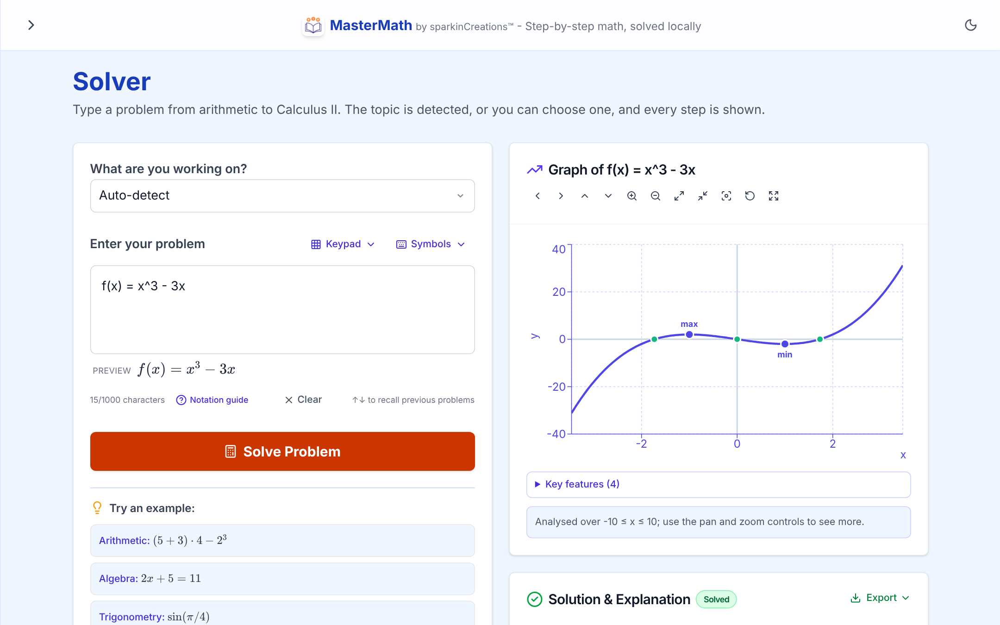
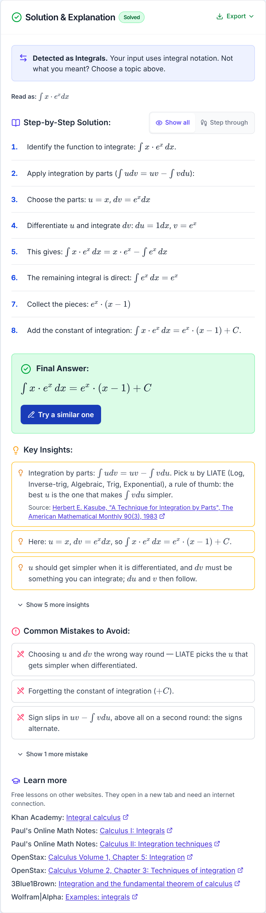
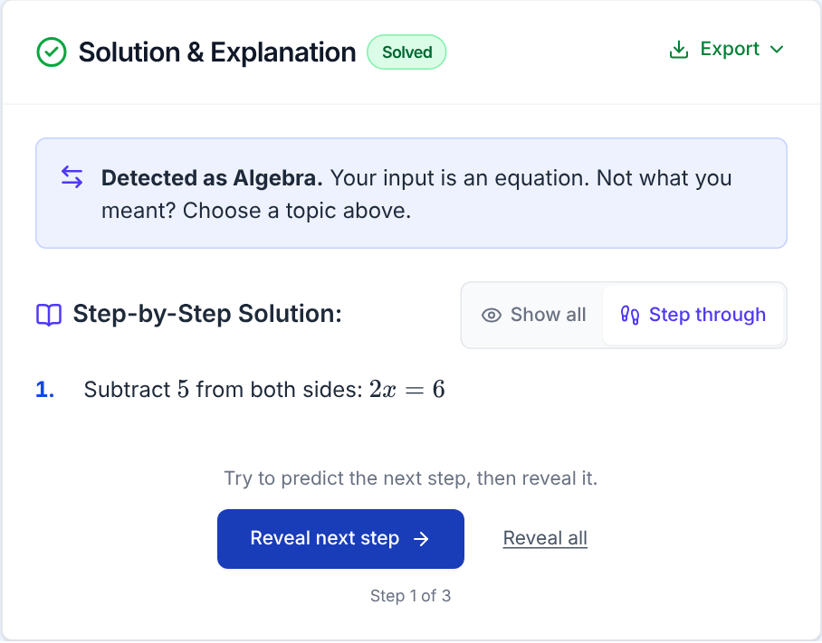
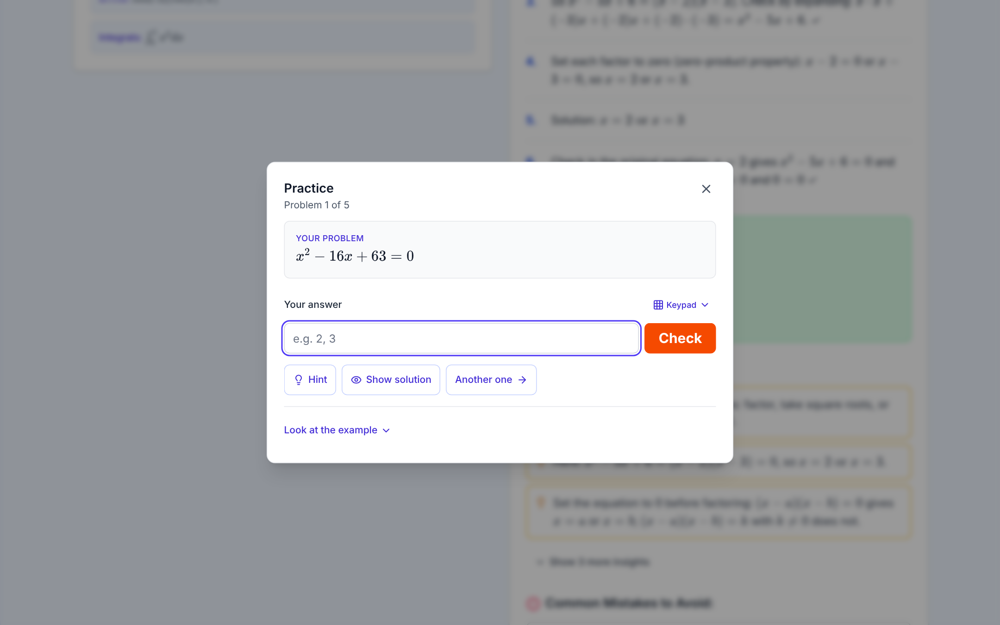
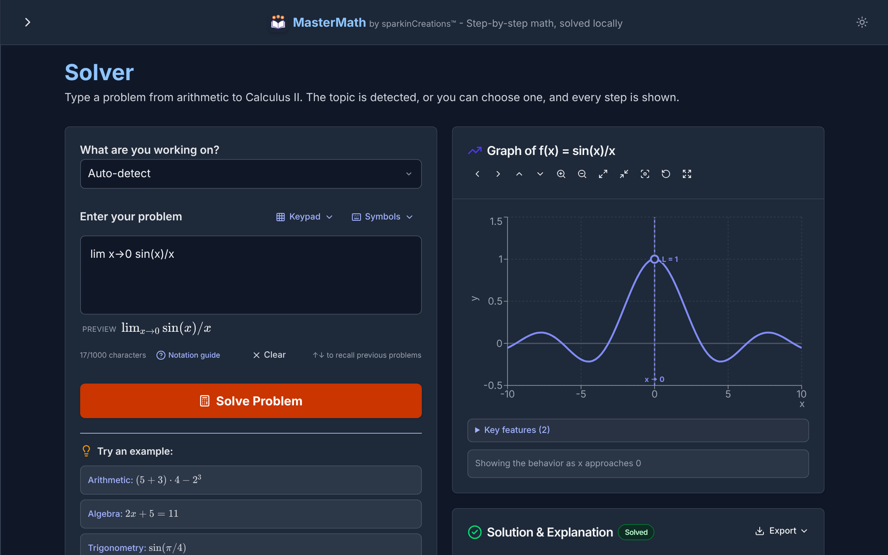
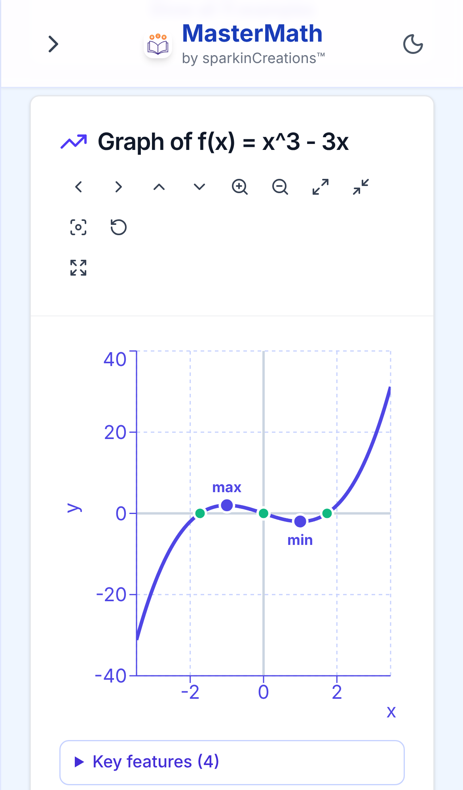
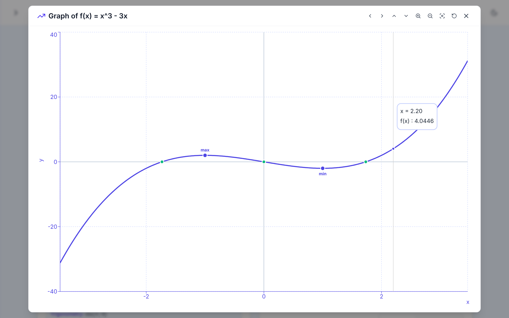

# MasterMath

A step-by-step math solver that runs in your browser. It covers arithmetic
through Calculus II and shows how each answer is reached, using open-source
math libraries rather than AI.

**Use it at [mastermath.app](https://mastermath.app).** It's free, needs no
account, and works offline once it has loaded.

[](LICENSE)
[](https://react.dev/)
[](https://vitejs.dev/)



## What it solves

| Topic | Examples |
|---|---|
| Arithmetic | order of operations, fractions, percentages, gcd and lcm |
| Algebra | linear, quadratic and higher-degree equations; radical, absolute-value, exponential and log equations; factoring, expanding, simplifying |
| Systems | two or three linear equations; a line with a parabola or circle |
| Inequalities | polynomial and rational inequalities by sign chart; compound inequalities |
| Trigonometry | exact values, identities, equations with all solutions |
| Functions | domain, intercepts, extrema, asymptotes, holes, with a graph |
| Limits | one-sided and at infinity, with the technique named |
| Derivatives | every rule worked, any order up to 4, at a point, implicit dy/dx |
| Integrals | substitution, parts, partial fractions, trig substitution, trig powers; definite and improper |

You can type the way you'd write it on paper (`2x + 5 = 11`, `x²`, `∫ x dx`,
`d/dx sin(3x)`) or in words (`the derivative of x squared`). Letters written
side by side multiply (`ax` is a·x), and an answer that contains constants
says when it holds, for example `x = −b/a, for a ≠ 0`. The topic is detected
automatically, or you can choose it.

## How answers are checked

The app is built on a few rules:

- **Every answer is checked before it's shown.** Equation roots are substituted
  back into the original equation; antiderivatives are differentiated back;
  definite integrals are compared with numerical integration; limits are
  checked numerically. A root that doesn't work is rejected, and the step
  says why.
- **It refuses rather than guesses.** When a problem is outside what the
  solver can do reliably, it says so and explains why. It doesn't return a
  plausible-looking answer it can't back up.
- **Exact values come first.** Fractions, roots and π stay exact (`18/5`,
  `√2`, `π/6`), with a decimal alongside, marked `≈` when it's rounded.
- **The steps follow the method.** You see the working a textbook would show:
  the discriminant, the sign chart, u and dv, the common denominator. Tips
  and common mistakes are specific to the method used.



## Learning features

- **Step through a solution** one line at a time, trying to predict the next
  step before revealing it.
- **Try a similar one:** after solving, practise on up to five problems that use
  the same method. Your answers are checked by value, so `2, 3` and `3, 2`
  are both accepted.
- **Graphs** mark the extrema, intercepts, asymptotes and holes. You can drag
  to pan, pinch or Ctrl/⌘-scroll to zoom, or expand the graph to full screen.
- **History:** solved problems are saved in your browser, and you can reopen
  any of them.
- **Export** a solution as a PDF (typeset, with the graph), Markdown, JSON or
  CSV.

| Step-through mode | Practice |
|---|---|
|  |  |

| Dark mode | Phone | Full-screen graph |
|---|---|---|
|  |  |  |

## Privacy

Every problem is solved on your own device, in a Web Worker in your browser.
Nothing you type is sent to a server, and your history is stored only in
your browser (IndexedDB). There is no account, no tracking and no analytics.

The one exception is the Feedback page: when you submit a message, it's
sent through Web3Forms. The "Learn more" links open other sites (Khan
Academy, OpenStax and others) in a new tab. MasterMath sends them nothing,
but visiting a site is an ordinary visit.

## Accessibility

- Math is rendered by KaTeX with MathML, so screen readers read it as math.
- Every page is checked against WCAG 2.1 AA with axe in light and dark mode,
  and every control is reachable from the keyboard.
- Each graph comes with a text description and a list of its key features.
- The app respects reduced-motion settings, and it has an on-screen keypad for
  phones and tablets.

Details are in [docs/ACCESSIBILITY.md](docs/ACCESSIBILITY.md).

## Running it locally

You need Node.js 22.

```bash
git clone https://github.com/sparkinCreations/MasterMath.git
cd MasterMath
npm install
npm run dev        # development server
npm test           # unit tests
npm run smoke      # browser tests of the production build (Playwright)
npm run build      # production build in dist/
```

## Testing

- `npm test` runs the unit suite with Node's built-in test runner. It
  includes:
  - a randomized cross-check of answers against a numerical oracle;
  - graded evaluation corpora, where the bar is zero confidently wrong
    answers;
  - regression tests for every math bug that has been fixed.
- `npm run smoke` runs Playwright against the production build on a desktop
  and a phone viewport. It covers every example problem, the worker and its
  time limit, the security headers, PDF export, and accessibility checks in
  both themes.

Both run in GitHub Actions on every push, and the deploy is blocked if the
unit suite fails.

## Built with

- [React 19](https://react.dev/) and [Vite](https://vitejs.dev/), with
  [React Router](https://reactrouter.com/)
- [Algebrite](https://github.com/davidedc/Algebrite) for symbolic algebra and
  calculus, and [math.js](https://mathjs.org/) for parsing and numerics
- [KaTeX](https://katex.org/) for typesetting and
  [Recharts](https://recharts.org/) for graphs
- [Tailwind CSS](https://tailwindcss.com/), shadcn/ui components,
  [Lucide](https://lucide.dev/) icons and
  [Framer Motion](https://www.framer.com/motion/)
- [jsPDF](https://github.com/parallax/jsPDF) and html2canvas-pro for PDF
  export

## Project layout

```
src/
  pages/              one component per page (Home, Solver, Progress, Settings, …)
  components/solver/  problem input, solution display, graph, practice
  lib/                routing of a problem to a solver, the worker, parsing, exports, storage
  lib/solvers/        one solver per topic, each documented at the top of its file
tests/                unit tests and the evaluation-corpus harness
e2e/                  Playwright smoke and accessibility tests
docs/                 how the app works, accessibility, evaluations, roadmap
public/               service worker, security headers, icons, manifest
```

Start with [CLAUDE.md](CLAUDE.md) for the architecture, the solver rules and
the release process, and [docs/HOW_THE_APP_WORKS.md](docs/HOW_THE_APP_WORKS.md)
for a walkthrough. The [CHANGELOG](CHANGELOG.md) lists every release.

## Contributing

Bug reports are especially welcome: a problem that gets a wrong answer, an
answer that's missing a condition, or a step that's hard to follow. Please
include the exact input you typed. See [CONTRIBUTING.md](CONTRIBUTING.md) for
how to set up and submit changes, and [SECURITY.md](SECURITY.md) for
reporting security issues.

## A note on use

MasterMath is meant to help you understand how a problem is solved. Check
important answers independently, and follow your school's rules on what help
is allowed.

## License and contact

MIT licensed; see [LICENSE](LICENSE).

MasterMath is made by [sparkinCreations™](https://sparkincreations.com).
Questions: admin@sparkincreations.com, or
[open an issue](https://github.com/sparkinCreations/MasterMath/issues).
