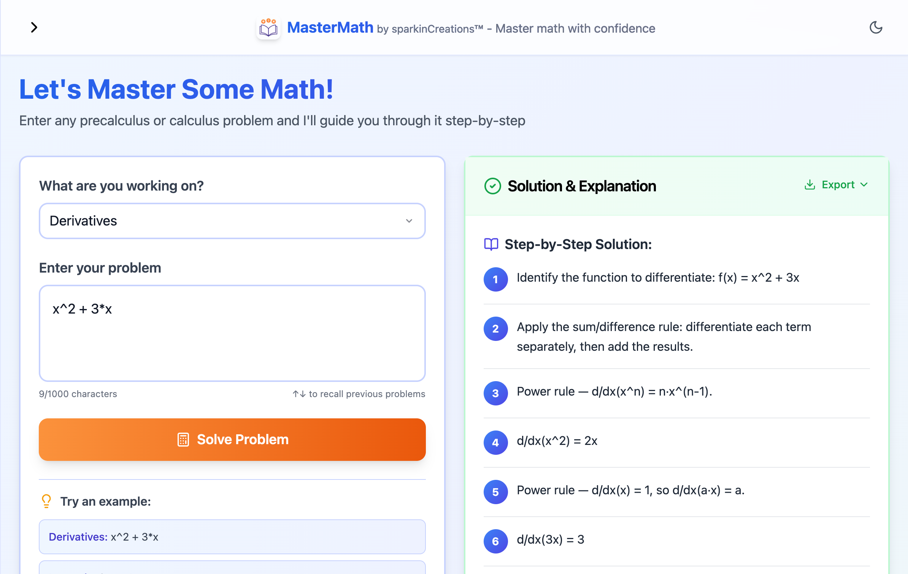

# 📚 MasterMath

> **A privacy-focused educational math solver that helps students master precalculus and calculus concepts through step-by-step solutions — powered by open-source math libraries, not AI.**

🌐 **Live at [mastermath.app](https://mastermath.app)**

[](https://opensource.org/licenses/MIT)
[](https://reactjs.org/)
[](https://vitejs.dev/)



## 🌟 Features

### 🧮 **Comprehensive Math Solver**
- **Derivatives & Differentiation** - Worked term-by-term, showing the rule used and the intermediate result for each term
- **Integrals & Integration** - Real per-term antiderivatives with the technique worked (power rule, u-substitution, by parts, partial fractions, trigonometric substitution, trig powers and reduction formulas, u = eˣ and x = u²); a definite integral no method can do is estimated numerically and says so
- **Limits** - Symbolic strategy ladder (substitution → simplify → Taylor series → L'Hôpital), with answers independently cross-checked
- **Algebra** - Equation solving with exact roots (radicals and complex numbers included)
- **Trigonometry** - Special angles, degree/radian handling, and honest "Undefined" at vertical asymptotes
- **Functions & Graphing** - Visual function analysis
- **Arithmetic** - Order-of-operations walkthroughs

### 📊 **Visual Learning**
- **Interactive Graphs** - Visualize functions and solutions
- **Step-by-Step Explanations** - Understand the process, not just the answer
- **Common Mistakes Warnings** - Learn what to avoid
- **Educational Tips** - Contextual learning guidance

### 🔒 **Privacy-First Design**
- **100% Client-Side** - Problems are solved in your browser, never sent to a server; no AI. The one thing that leaves your device is a message you choose to submit on the Feedback page (sent to Web3Forms)
- **Works Offline** - Installable PWA; solve problems with no connection at all
- **Local Storage** - Your problems stay on your device
- **No Account Required** - Start solving immediately
- **Export Functionality** - Save your work locally (PDF, CSV, JSON, Markdown)

### 🎨 **Modern User Experience**
- **Dark/Light Mode** - Comfortable viewing in any environment
- **Settings & Solver Preferences** - Choose your angle unit (auto/degrees/radians) and result precision
- **Responsive Design** - Works on desktop, tablet, and mobile
- **Progress Tracking** - Monitor your learning journey
- **Clean Interface** - Focus on learning, not distractions

## 🚀 Quick Start

### Prerequisites
- Node.js 18+ 
- npm or yarn

### Installation

```bash
# Clone the repository
git clone https://github.com/sparkinCreations/MasterMath.git
cd MasterMath

# Install dependencies
npm install

# Start development server
npm run dev

# Run the automated test suite
npm test

# Build for production
npm run build
```

### Usage

1. **Enter a Math Problem** - Type any precalculus or calculus problem
2. **Select Topic** - Choose the appropriate mathematical category
3. **Get Step-by-Step Solution** - Review detailed explanations
4. **Visualize Results** - View graphs when applicable
5. **Learn & Verify** - Always double-check solutions independently

## 🏗️ Technology Stack

### **Frontend Framework**
- **React 19** - Modern UI library with hooks
- **Vite** - Fast build tool and development server
- **React Router** - Client-side routing

### **Math Libraries**
- **Algebrite** - Symbolic calculus and algebra
- **MathJS** - Expression parsing and evaluation

### **Styling & UI**
- **Tailwind CSS** - Utility-first styling
- **shadcn/ui** - Modern component library
- **Lucide React** - Icon system
- **Framer Motion** - Animations

### **Charts & Visualization**
- **Recharts** - Interactive function graphs

### **Storage & Export**
- **IndexedDB** - Browser-based local storage
- **jsPDF** - PDF generation for exports

## 📖 How It Works

MasterMath uses **local JavaScript math libraries** (not AI) to solve problems:

1. **Math Parser** extracts expressions from natural language input
2. **Topic Router** directs problems to the appropriate solver
3. **Solver Engines** compute solutions using mathjs and algebrite
4. **Solution Formatter** generates step-by-step explanations, tips, and graphs
5. **Local Storage** saves your history in the browser (IndexedDB)

All computations happen **entirely in your browser** - your problems and history are never sent anywhere. The only outbound request is the Feedback form, and only when you submit it.

The solvers are covered by an automated unit suite (`npm test`) and a
Playwright browser smoke test of the production build (`npm run smoke`), both
run in GitHub Actions on every push. The unit suite includes a regression suite that pins every previously-fixed math bug —
from `tan(π/2)` floating-point artifacts to cancellation-prone limits —
so they can't silently return.

## 📖 Educational Philosophy

MasterMath is designed as a **learning companion**, not a homework shortcut:

### ✅ **Use For:**
- Understanding solution steps
- Verifying your work
- Learning problem-solving patterns
- Building mathematical intuition

### ⚠️ **Important:**
- Always verify solutions independently
- Use as a learning aid, not a replacement for practice
- Respect your institution's academic integrity policies

## 🗂️ Project Structure

```
src/
  pages/               one component per route (Home, Solver, Progress, Settings, …)
  components/solver/   ProblemInput, SolutionDisplay, GraphViewer
  components/ui/       shadcn/ui primitives
  lib/                 api.js (routing), budgetedSolver.js (worker + time budget), mathParser.js, settings.js, exports, storage
  lib/solvers/         one module per topic, each documented at the top of its file
tests/                 unit suite and the evaluation-corpus harness
e2e/                   Playwright smoke and accessibility tests of the production build
docs/                  how the app works, evaluation records, roadmap
public/                service worker, security headers, icons, manifest
```

The architecture, solver invariants and release process are in
[CLAUDE.md](CLAUDE.md); a narrative walkthrough is in
[docs/HOW_THE_APP_WORKS.md](docs/HOW_THE_APP_WORKS.md).

## 🤝 Contributing

We welcome contributions from the community! Please see our [Contributing Guidelines](CONTRIBUTING.md) for details.

### **Ways to Contribute:**
- 🐛 **Bug Reports** - Find and report issues
- ✨ **Feature Requests** - Suggest new functionality
- 📝 **Documentation** - Improve guides and examples
- 🧮 **Math Solvers** - Add new mathematical topics
- 🎨 **UI/UX** - Enhance user experience
- 🧪 **Testing** - Add test coverage

### **Development Setup:**
1. Fork the repository
2. Create a feature branch: `git checkout -b feature/amazing-feature`
3. Make your changes and test thoroughly
4. Commit with clear messages: `git commit -m 'Add amazing feature'`
5. Push to your fork: `git push origin feature/amazing-feature`
6. Open a Pull Request

## 📄 License

This project is licensed under the MIT License - see the [LICENSE](LICENSE) file for details.

## 🏢 About sparkinCreations™

MasterMath is developed by [sparkinCreations™](https://sparkincreations.com), committed to creating educational tools that promote learning and understanding.

### **Contact:**
- 🌐 **Website:** [sparkincreations.com](https://sparkincreations.com)
- 📧 **Email:** admin@sparkincreations.com
- 💬 **Issues:** [GitHub Issues](https://github.com/sparkinCreations/MasterMath/issues)

## 🙏 Acknowledgments

- **Math Libraries** - Algebrite and MathJS communities
- **UI Framework** - React and Vite teams
- **Open Source** - All the amazing libraries that make this possible

## ⚠️ Important Notice

**MasterMath is an educational tool designed to help students learn mathematical concepts. All computations are performed using JavaScript math libraries (not AI). Always verify solutions independently and respect your institution's academic integrity policies.**

---

**Made with ❤️ by sparkinCreations™ • Powered by ⚛️ React**

*Master math with confidence!*
